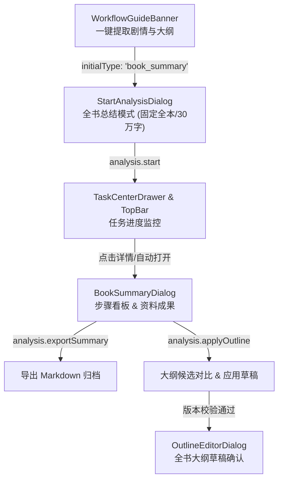

# 全书剧情提取与大纲前端任务实施计划

本文档基于 [`docs/book-summary-api.md`](file:///E:/%E5%B0%8F%E8%AF%B4%E5%B7%A5%E4%BD%9C%E6%B5%81/%E5%B0%8F%E8%AF%B4/docs/book-summary-api.md) 第 7 节“现有前端待接入位置”及相关后端接口规范，制定全书总结（`book_summary`）完整前端交互设计与接入计划。

---

## 目标与背景

后端已完整实现基于明月 13 类提示词的全书滚动总结与全书大纲生成流水线（小总结、主线、阶段大总结、8 类专项资料、体系判断与超级总结），并提供了标准 IPC 接口：
- `window.novelAgent.analysis.start({ type: 'book_summary', scope: { all: true, segmentSize, stageSize }, ... })`
- `window.novelAgent.task.get({ sessionId, taskId })` 返回带 `bookSummary: BookSummaryResult` 的 `TaskDetail`
- `window.novelAgent.analysis.applyOutline({ sessionId, taskId, expectedVersion })`
- `window.novelAgent.analysis.exportSummary({ sessionId, taskId })`
- `window.novelAgent.task.onProgress` 进度订阅及控制方法（`pause`, `resume`, `retry`, `retryStep`, `cancel`）

本计划负责落实 4 大前端接入需求：
1. **工作台一键入口调整**：`WorkbenchLayout.tsx` 的“一键提取剧情与大纲”改为传递 `initialType: 'book_summary'`。
2. **发起分析弹窗优化**：`StartAnalysisDialog.tsx` 全书总结模式固定整本范围、移除章节勾选；阶段阈值默认改为 `300,000`（不影响文风蒸馏的 `1,000,000`）。
3. **全书总结任务详情与成果看板**：新增 `BookSummaryDialog.tsx`，通过 `stepPlan` 展示步骤流与状态，通过 `artifacts` 展示完整资料，提供关系图谱、体系判断卡片、一键复制、Markdown 导出、候选大纲对比与版本冲突乐观锁应用，严格禁用跳过操作。
4. **工作流冷启动指引条件**：`WorkflowGuideBanner.tsx` 完成条件从判断 `chapter_summary` 改为判断是否存在成功且来源有效的 `book_summary` 或梗概（`synopsis`）。

---

## User Review Required

> [!IMPORTANT]
> **关于全书大纲替换机制**：
> 当全书大纲已存在时，本流程不自动覆盖原稿，大纲候选保留在 `task.bookSummary.outlineCandidate`。用户在任务成果面板中点击“对比并应用大纲”时，前端获取当前 `BookOutline.version` 并通过 `applyOutline({ expectedVersion })` 发起原子写入。若在对比期间大纲已被其他操作修改，后端返回 `VERSION_CONFLICT`，前端将重新拉取并提示作者再次对比，确保作者权威性与数据安全。

> [!NOTE]
> **禁用跳过步骤（Skip Step）**：
> 全书总结所有 14 类步骤具有前后严格数据依赖（如小总结输入大总结、大总结输入专项资料、首阶段体系判断制约后续体系表生成）。任务详情与任务队列中对 `book_summary` 任务均隐藏或禁用 `skipStep` 按钮。

---

## Open Questions

无阻塞性问题。默认行为如下：
1. 从 `StartAnalysisDialog` 发起 `book_summary` 成功后，自动打开 `BookSummaryDialog`，方便作者实时观察 14 步流水线与实时生成的资料。
2. 在 `TaskCenterDrawer` 任务列表中，为 `book_summary` 任务增加“查看步骤与成果”按钮，点击随时调起 `BookSummaryDialog`。

---

## Proposed Changes



---

### 1. 状态管理与路由扩展

#### [MODIFY] [`src/renderer/stores/useWorkbenchStore.ts`](file:///E:/%E5%B0%8F%E8%AF%B4%E5%B7%A5%E4%BD%9C%E6%B5%81/%E5%B0%8F%E8%AF%B4/src/renderer/stores/useWorkbenchStore.ts)
- 在 `DialogType` 中新增 `'book_summary'`。
- 支持 `openDialog('book_summary', { taskId: string })`。

---

### 2. 工作台冷启动引导与入口

#### [MODIFY] [`src/renderer/components/workbench/WorkflowGuideBanner.tsx`](file:///E:/%E5%B0%8F%E8%AF%B4%E5%B7%A5%E4%BD%9C%E6%B5%81/%E5%B0%8F%E8%AF%B4/src/renderer/components/workbench/WorkflowGuideBanner.tsx)
- 更新接口属性：将基于数量的 `summaryCount: number` 改为语义清晰的 `hasValidSummary: boolean`（当全书总结有效或梗概有效时为 `true`）。
- 按钮文本保持“一键提取剧情与大纲”，点击触发 `onStartKnowledgeAnalysis`（实际传入 `book_summary`）。

#### [MODIFY] [`src/renderer/features/workbench/WorkbenchLayout.tsx`](file:///E:/%E5%B0%8F%E8%AF%B4%E5%B7%A5%E4%BD%9C%E6%B5%81/%E5%B0%8F%E8%AF%B4/src/renderer/features/workbench/WorkbenchLayout.tsx)
- 检查全书总结状态：
  - 调用 `synopsis.get({ sessionId })` 检查是否存在 `state === 'current'` 的梗概；或检查 `task.list({ sessionId, type: 'book_summary' })` 是否有已完成且未过时的全书总结。
  - 将有效状态设置给 `hasValidSummary`。
- 将 WorkflowGuideBanner 的 `onStartKnowledgeAnalysis` 触发参数改为 `{ initialType: 'book_summary' }`。

---

### 3. 发起分析对话框改造

#### [MODIFY] [`src/renderer/components/dialogs/StartAnalysisDialog.tsx`](file:///E:/%E5%B0%8F%E8%AF%B4%E5%B7%A5%E4%BD%9C%E6%B5%81/%E5%B0%8F%E8%AF%B4/src/renderer/components/dialogs/StartAnalysisDialog.tsx)
- **阶段字数阈值**：
  - 当 `taskType === 'book_summary'` 时，`stageSize` 默认值设为 `'300000'`；当切换为 `style_distill` 时保持 `'1000000'`。
  - `handleStart` 中构造 `scope`：`taskType === 'book_summary'` 固定传 `{ all: true, segmentSize: Number(segmentSize) || 50000, stageSize: Number(stageSize) || 300000 }`。
- **范围选择区隐藏**：
  - 当 `taskType === 'book_summary'` 时，隐藏章节自定义勾选面板，提示“全书总结将分析全书未删除章节（共 X 章），不抽样、不截断”。
- **回调传递**：
  - `onStarted: (taskId: string, taskType: string) => void`，方便宿主判断是否直接打开全书总结面板。
- **约束保障**：严格遵守不使用原生 `<input>`，使用 `@appica/ui-react/input` 组件。

---

### 4. 全书总结成果与步骤看板 (核心新增)

#### [NEW] [`src/renderer/components/dialogs/BookSummaryDialog.tsx`](file:///E:/%E5%B0%8F%E8%AF%B4%E5%B7%A5%E4%BD%9C%E6%B5%81/%E5%B0%8F%E8%AF%B4/src/renderer/components/dialogs/BookSummaryDialog.tsx)
实现全功能全书总结看板（符合 UI 规范：`DialogContent frame={false} closeButton={false}`）：
1. **任务概况顶栏**：
   - 任务标题、状态徽标（执行中、已完成、已中断、失败、已取消）。
   - 过时提示（`resultState === 'stale'` 时展示橙色警示：“章节来源已修改，产物已过时，不能续跑或应用大纲，建议新建任务”）。
   - 操作按钮群：
     - 执行中：暂停 (`analysis.pause`)、取消 (`analysis.cancel`)。
     - 已中断/失败且来源有效：继续执行 (`analysis.resume`)、重试任务 (`task.retry`)。
     - 导出文档：导出为完整 Markdown 文件 (`analysis.exportSummary`)。
     - 比较并应用大纲：存在 `outlineCandidate` 且未过时时可用。
2. **左侧步骤导航树（`stepPlan` + `task.steps`）**：
   - 按阶段组织呈现全部步骤：小总结、主线、阶段大总结、8类专项资料（伏笔、人物、世界观、关系、体系判断、体系、时间线、地点、未解问题）、超级总结、全书大纲候选。
   - 步骤状态图标（成功绿勾、运行旋转、等待灰色、失败红叹号）。
   - 单步失败提供“重试此步骤”按钮（`task.retryStep`），**无跳过选项**。
3. **右侧资料详情展示区（`artifacts`）**：
   - 资料标题与正文来源坐标（章节范围与字符偏移）。
   - “复制文本”按钮（支持快速复制 Markdown 内容）。
   - 专项资料定制视图：
     - **人物关系图谱 (`graph`)**：展示节点角色权重与有向关系连线（类型、说明、强度 1-5）。
     - **体系判断 (`assessment`)**：展示适用性（适用/不适用）、体系标签、判断理由与关键维度。
     - **不适用标记 (`notApplicable`)**：显示不适用原因说明。
4. **大纲对比与应用弹层/抽屉**：
   - 读取当前全书大纲：`window.novelAgent.outline.getBookOutline({ sessionId })`。
   - 双栏对比当前大纲与候选大纲。
   - 点击“应用为全书大纲草稿”：
     - 传入 `expectedVersion: current?.version ?? 0` 调用 `analysis.applyOutline`。
     - 若发生 `VERSION_CONFLICT`，捕获并提示“全书大纲已被修改，已为您刷新最新内容，请重新对比”，并重载当前版本。
     - 成功后提示前往大纲编辑器确认。
5. **实时通信与清理**：
   - 组件挂载时调用 `task.get` 初始化。
   - 监听 `task.onProgress` 并在 `event.taskId === taskId` 时刷新状态。
   - 卸载时解除监听。

---

### 5. 任务中心集成与弹窗宿主

#### [MODIFY] [`src/renderer/components/ai/TaskRows.tsx`](file:///E:/%E5%B0%8F%E8%AF%B4%E5%B7%A5%E4%BD%9C%E6%B5%81/%E5%B0%8F%E8%AF%B4/src/renderer/components/ai/TaskRows.tsx)
- `TaskItem` 增加 `onViewDetails?: () => void`。
- 为任务卡片提供点击或“查看成果与步骤”按钮入口。

#### [MODIFY] [`src/renderer/features/drawer/TaskCenterDrawer.tsx`](file:///E:/%E5%B0%8F%E8%AF%B4%E5%B7%A5%E4%BD%9C%E6%B5%81/%E5%B0%8F%E8%AF%B4/src/renderer/features/drawer/TaskCenterDrawer.tsx)
- 在任务列表中为 `book_summary` 类型的任务注入 `onViewDetails: () => openDialog('book_summary', { taskId: task.id })`。

#### [MODIFY] [`src/renderer/features/dialogs/DialogHost.tsx`](file:///E:/%E5%B0%8F%E8%AF%B4%E5%B7%A5%E4%BD%9C%E6%B5%81/%E5%B0%8F%E8%AF%B4/src/renderer/features/dialogs/DialogHost.tsx)
- 引入并挂载 `BookSummaryDialog`：
  ```tsx
  {activeDialog === 'book_summary' && (
    <BookSummaryDialog
      sessionId={sessionId}
      taskId={(dialogPayload as any)?.taskId}
      isReadOnly={isReadOnly}
      onClose={closeDialog}
      onOpenOutlineEditor={() => openDialog('outline')}
    />
  )}
  ```
- `StartAnalysisDialog` 启动后，若为 `book_summary` 则联动 `openDialog('book_summary', { taskId })`。

---

## Verification Plan

### Automated Tests
1. **单元与交互测试**：
   - 新建 `tests/book-summary-frontend.test.tsx`：
     - 测试 `StartAnalysisDialog` 在 `taskType === 'book_summary'` 时固定整本范围、隐藏章节复选框、默认 300,000 阈值。
     - 测试 `BookSummaryDialog` 正确渲染 `stepPlan`、`artifacts`。
     - 测试关系图谱与体系判断信息的渲染。
     - 测试跳过步骤被严格禁止（不渲染跳过按钮）。
     - 测试导出按钮调用 `analysis.exportSummary`。
     - 测试大纲候选应用逻辑及 `VERSION_CONFLICT` 错误处理。
     - 测试 `resultState === 'stale'` 时显示过时提示且禁用应用大纲。
   - 更新 `tests/workflow-guide-banner.test.ts`：
     - 验证基于全书总结状态显示/隐藏 banner 及引导逻辑。
2. **运行测试命令**：
   - `pnpm vitest run tests/book-summary-frontend.test.tsx`
   - `pnpm vitest run tests/workflow-guide-banner.test.ts`
   - `pnpm vitest run tests/review-fixes.test.ts`
   - `pnpm test` (全量测试套件)

### Manual Verification
1. 打开含有章节的项目，观察首屏 banner 显示“一键提取剧情与大纲”。
2. 点击按钮打开 `StartAnalysisDialog`，默认选中“全书总结”，无章节勾选列表，阶段阈值为 300,000。
3. 点击“开始执行任务”，弹窗关闭并自动弹出 `BookSummaryDialog`，观察步骤流实时推进。
4. 在已完成步骤中点击查看“阶段 1 关系”与“首阶段体系判断”，检查图谱及判断卡片正常呈现，点击“复制”可将内容拷入剪贴板。
5. 任务完成后，点击“比较并应用全书大纲”，查看原大纲与候选大纲对比，点击应用后提示更新成功。
6. 点击“导出完整资料”，触发 Markdown 导出并得到文件路径提示。
